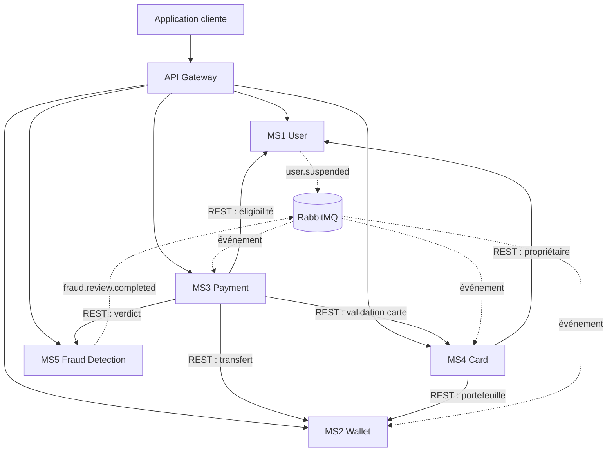

# SafePay — Secure Digital Payment Platform

**Projet académique | Architecture microservices | Année universitaire 2026–2027**

SafePay est un projet de plateforme de paiement numérique sécurisée. Il permet de concevoir la gestion de comptes utilisateurs, de portefeuilles électroniques, de paiements, de transferts d'argent et de cartes virtuelles, tout en intégrant un système de détection des transactions suspectes.

> **État du projet :** phase de conception et de développement progressif. Les composants, API et échanges ci-dessous décrivent l'architecture cible ; leur présence dans le document technique ne signifie pas qu'ils sont tous déjà implémentés.

## 1. Problématique et objectifs

**Problématique :** comment améliorer la détection et la prévention de la fraude dans les services financiers numériques ?

Nos objectifs sont de :

- Faciliter les paiements et les transferts d'argent.
- Permettre aux clients de gérer leurs portefeuilles et leurs cartes virtuelles.
- Analyser le risque de fraude **avant** l'exécution des mouvements de fonds.
- Conserver un historique des opérations et des changements de statut.
- Concevoir une application évolutive, maintenable et sécurisée grâce aux microservices.

## 2. Principales fonctionnalités

**Client :** inscription, authentification, gestion du profil, consultation et alimentation du portefeuille, paiements, transferts, création et blocage des cartes virtuelles, consultation des historiques et des alertes.

**Administrateur :** gestion des utilisateurs, activation ou suspension des comptes et suivi du statut KYC (*Know Your Customer*).

**Analyste fraude :** consultation des alertes et examen des transactions suspectes, avec une décision de revue selon les règles retenues pour le projet.

**Détection automatique :** calcul d'un score de risque et émission d'un verdict `APPROVED`, `SUSPICIOUS` ou `REJECTED`.

## 3. Architecture microservices

SafePay repose sur **cinq microservices**, chacun responsable de ses données et de sa logique métier.

| Microservice | Responsabilité principale | Base de données | Port prévu |
|---|---|---|---|
| **MS1 — User Service** | Profils, rôles, statut KYC et état des comptes | H2 (`DB_USER`) | `8081` |
| **MS2 — Wallet Service** | Portefeuilles, soldes, débits/crédits et mouvements | H2 (`DB_WALLET`) | `8082` |
| **MS3 — Payment Service** | Orchestration des paiements, transferts et statuts | H2 (`DB_PAYMENT`) | `8083` |
| **MS4 — Card Service** | Cartes virtuelles, plafonds, blocage et déblocage | MySQL (`DB_CARD`) | `8084` |
| **MS5 — Fraud Detection** | Scoring antifraude, vérifications et alertes | PostgreSQL (`DB_FRAUD`) | `8085` |

### Composants transverses prévus

- **Spring Boot / Spring Data JPA** : développement des microservices et gestion des données.
- **API Gateway** : point d'entrée des requêtes et routage vers les services.
- **Eureka** : découverte et enregistrement des instances des microservices.
- **Spring Cloud Config Server** : centralisation des configurations.
- **REST / OpenFeign** : appels synchrones entre microservices.
- **RabbitMQ** : échange asynchrone d'événements.
- **Keycloak / OAuth2 / OIDC / JWT** : authentification et contrôle des accès.
- **Docker / Docker Compose** : conteneurisation et lancement coordonné envisagés.
- **OpenAPI / Swagger** : documentation des contrats REST.

### Vue simplifiée des relations



**Principe de séparation :** chaque microservice possède sa propre base de données. Les références `userId`, `walletId`, `cardId` et `paymentId` sont des **références logiques** entre services : elles ne correspondent pas à des clés étrangères SQL entre bases différentes.

## 4. API REST principales (contrats prévus)

| Service | Méthode | Endpoint | Utilisation |
|---|---|---|---|
| User | `GET` | `/api/users/me` | Consulter son profil |
| User | `PATCH` | `/api/users/me` | Modifier son profil |
| User | `GET` | `/internal/users/{id}/eligibility` | Vérifier l'éligibilité d'un client |
| Wallet | `POST` | `/api/wallets` | Créer un portefeuille |
| Wallet | `GET` | `/api/wallets/me` | Consulter son portefeuille |
| Wallet | `POST` | `/internal/wallets/transfers` | Exécuter un transfert |
| Payment | `POST` | `/api/payments` | Demander un paiement |
| Payment | `POST` | `/api/transfers` | Demander un transfert |
| Payment | `GET` | `/api/payments/{id}` | Consulter une transaction |
| Card | `POST` | `/api/cards` | Créer une carte virtuelle |
| Card | `GET` | `/api/cards/{id}` | Consulter une carte |
| Card | `PATCH` | `/api/cards/{id}/block` | Bloquer une carte |
| Card | `PATCH` | `/api/cards/{id}/unblock` | Débloquer une carte |
| Card | `PUT` | `/api/cards/{id}/limit` | Modifier le plafond |
| Card | `POST` | `/internal/cards/{id}/validate-payment` | Vérifier une carte avant paiement |
| Fraud | `POST` | `/internal/fraud/checks` | Analyser le risque d'une transaction |
| Fraud | `GET` | `/api/admin/fraud/alerts` | Consulter les alertes |
| Fraud | `PATCH` | `/api/admin/fraud/alerts/{id}/decision` | Enregistrer une décision de revue |

Les routes `/internal/**` sont destinées aux échanges sécurisés **entre microservices** et ne doivent pas être exposées publiquement.

## 5. Exemple : déroulement d'un transfert

1. Un client authentifié demande un transfert via `POST /api/transfers`.
2. **Payment** enregistre la demande et interroge **User** pour vérifier l'éligibilité du client.
3. **Payment** demande un verdict à **Fraud Detection** avant tout mouvement d'argent.
4. Si le verdict est `APPROVED`, **Payment** demande à **Wallet** d'effectuer le débit et le crédit de manière atomique.
5. **Payment** enregistre le résultat et peut publier l'événement `payment.completed`.
6. Si la transaction est suspecte, elle est placée en `PENDING_REVIEW` **sans mouvement de fonds**, en attente de revue.

## 6. Communication et sécurité

- **Synchrone (REST / OpenFeign)** : pour obtenir immédiatement un résultat nécessaire à une opération, comme la validation d'une carte ou le verdict antifraude.
- **Asynchrone (RabbitMQ)** : pour diffuser des événements tels que `user.suspended`, `card.blocked`, `fraud.alert.created`, `fraud.review.completed` ou `payment.completed`.
- **Authentification** : Keycloak authentifie les utilisateurs et émet les JWT ; User Service conserve les profils, rôles et statuts KYC.
- **Traçabilité** : les historiques des paiements, des cartes et des portefeuilles permettent de suivre les opérations.
- **Fiabilité envisagée** : idempotence, gestion des timeouts, circuit breaker et compensation en cas d'échec.
- **Sécurité des cartes** : la conception prévoit des cartes simulées ou tokenisées, sans conservation du numéro complet.

## 7. Structure du dépôt

```text
SafePay-Microservices/
├── Backend/          # Microservices et composants backend
├── Frontend/         # Interface utilisateur
├── Documentation/    # Présentation, diagrammes et dossier technique
│   ├── Presentation/
│   ├── Diagrams/
│   └── Dossier-Technique/
└── README.md
```

> L'arborescence représente l'**organisation cible** du dépôt. Certains dossiers ou composants peuvent encore être en cours de création.

## 8. Lancement du projet

Le lancement complet via **Docker Compose** est prévu dans l'architecture. Les instructions d'exécution seront complétées au fur et à mesure de l'intégration des services (fichiers Docker, configuration des bases, variables d'environnement et commandes de démarrage).

**Prérequis envisagés :** JDK compatible avec le projet Spring Boot, Maven, Docker et Docker Compose ; Node.js et Angular CLI pour le frontend si cette technologie est retenue lors du développement.

**Bonne pratique :** ne jamais publier de mots de passe, tokens ni secrets dans le dépôt Git.

## 9. Répartition de l'équipe

| Membre | Responsabilité principale |
|---|---|
| **Rahmouni Yassmine** | MS1 — User Service |
| **Bougacha Mohamed Aziz** | MS2 — Wallet Service |
| **Kobbi Yosr** | MS3 — Payment Service |
| **Mhiri Mohamed Fedi** | MS4 — Card Service |
| **Toute l'équipe** | MS5 — Fraud Detection |

**Encadrante :** Ben Salah Ons  
**Année universitaire :** 2026–2027

## 10. Étapes du projet

- [x] Définition du sujet, des acteurs et des fonctionnalités.
- [x] Conception de l'architecture cible et du découpage en microservices.
- [x] Définition des modèles de données et des contrats d'API dans le document technique.
- [ ] Développement et tests des cinq microservices.
- [ ] Intégration REST, RabbitMQ, Keycloak, Eureka et Config Server.
- [ ] Réalisation et intégration du frontend.
- [ ] Conteneurisation et tests de bout en bout.

> Les cases ci-dessus décrivent la progression documentaire connue et les prochaines étapes prévues, pas une vérification du contenu actuel du code GitHub.

---

**SafePay** — Projet pédagogique de conception d'une architecture de paiement numérique sécurisée. Aucun service bancaire réel n'est intégré à ce stade.
